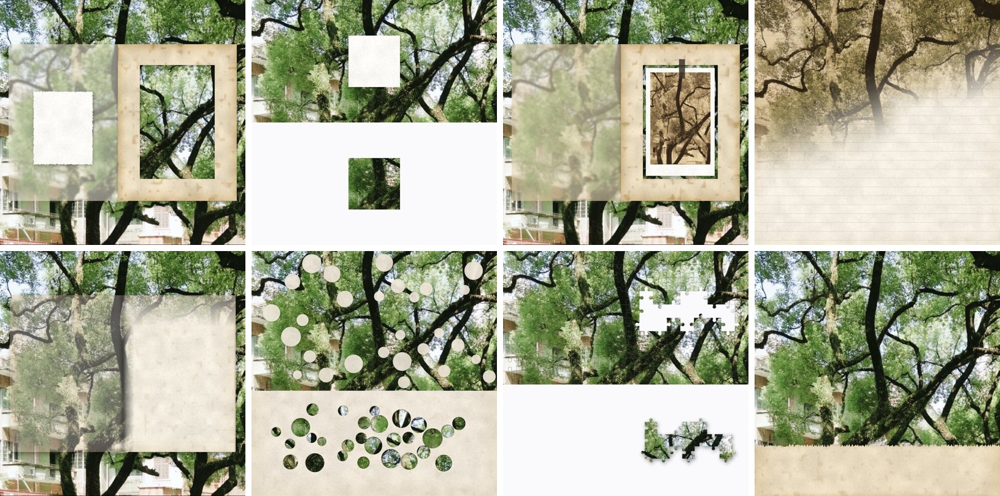

# Paper Collage · 纸艺拼贴 Skill

将照片合成为纸艺拼贴、手账风图片。包含 **8 款样式**、自适应纸色、半透明纸层和可填写的文字区域。基于原图像素与 Canvas 2D 合成，无需 LLM 或生图 API。

## 样式

| 样式 | 参考图 | 样式 | 参考图 |
| --- | --- | --- | --- |
| 纸框开窗 | [预览](references/style-1.jpg) | 摊开的书 | [预览](references/style-5.jpg) |
| 留白卡片 | [预览](references/style-2.jpg) | 圆形打孔 | [预览](references/style-6.jpg) |
| 复古相片 | [预览](references/style-3.jpg) | 拼图 | [预览](references/style-7.jpg) |
| 横线本 | [预览](references/style-4.jpg) | 底部纸条 | [预览](references/style-8.jpg) |



其他输出示例：[横图](examples/16x9_blank.jpg) · [竖图与填写文字](examples/9x16_with_text.jpg)。示例用于展示效果，默认输出不含新增文字。

## 文件说明

```text
SKILL.md                  AI 助手的使用指引
README.md                 介绍与 API 用法
src/paper-collage.js       Canvas 2D 渲染代码（v1.2.0）
references/styles.md       八款样式的细节说明
references/style-*.jpg     样式参考图
examples/                 三种比例的输出示例
```

将整个目录放入支持 `SKILL.md` 的助手的技能目录，保留上述相对路径。此包提供照片样式处理，不包含相册排版、PDF 导出或任何特定站点的接入代码。

## 运行与 API

渲染代码需要浏览器 DOM、Canvas 2D 和 Image API，不能直接在普通 Node.js 环境运行。加载 `src/paper-collage.js` 后，使用全局对象 `PaperCollage`；代码本身无第三方运行依赖。

单张处理，`img` 为已加载的图片或 Canvas：

```js
const { canvas, layout } = PaperCollage.render(img, {
  template: 'bottom_strip',
  seed: 7,
  maxSide: 1600,
  palette: 'auto'
});
// canvas：输出图像；layout：尺寸、配色与文字区域
```

批量处理，`files` 可为 File / Blob / URL / 已加载图片的列表：

```js
// 自动按照片的颜色、亮度等信息选择样式，可能重复。
const results = await PaperCollage.renderBatch(files, { maxSide: 1600 });

// 需要样式不重复时，显式分配模板。
const templates = PaperCollage.pickTemplates(files.length, 7);
const varied = await PaperCollage.renderBatch(files, {
  seed: 7,
  maxSide: 1600,
  templates
});
// 每项包含 { canvas, layout, source, index }
```

可选填写用户提供的文字，返回新画布：

```js
const withText = PaperCollage.drawText(canvas, layout, '用户提供的文字', {
  fontFamily: 'sans-serif',
  fontSize: 24
});
```

| 方法 | 作用 |
| --- | --- |
| `render(img, options)` | 单张生成；`template: 'auto'` 自动选择样式 |
| `renderBatch(sources, options)` | 依次生成多张，可传 `templates` 和 `onProgress` |
| `pickTemplates(n, seed, allowed)` | 分轮打乱可用样式，减少重复 |
| `analyzeImage(img)` | 获取整体及局部颜色、亮度、饱和度统计 |
| `resolvePalette(analysis, template, options)` | 计算纸色、材质、透明度及文字颜色 |
| `drawText(canvas, layout, text, options)` | 在副本上填写文字；也可传 `{ regionId: '文字' }` |
| `templates` | 获取样式 ID、名称和介绍 |

### 参数与输出约定

- 默认保留输入比例；`maxSide` 限制长边，默认上限为 2048。显式同时设置 `width` 和 `height` 会覆盖默认尺寸行为。
- `palette: 'auto'` 根据照片配色；`'classic'` 使用经典纸色。
- `opacity` 为纸层不透明度（0.08–1），不改变模板自身的留白背景；`paperColor` 可覆盖纸张主色。
- `layout.text_regions` 提供区域的 `id`、`order`、`x/y/w/h`、`rel`、字号和行距；`circle_holes` 不提供文字区域。
- 默认字体为本机手写字体候选。指定其他字体时须自行加载；渲染库不下载字体。
- 长文本超出区域后可能无法完整显示，需检查输出并调整字号或缩短文字。
- 自动选择不识别人脸或主体，部分样式会遮挡或裁取照片区域，应检查最终效果。
- 使用远程图片时，图片来源需允许跨域读取，否则浏览器可能限制像素分析和图片导出。
